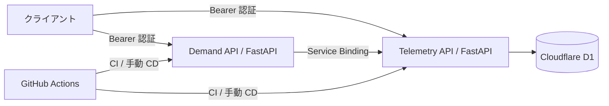

# EMS FastAPI Microservices

Python・FastAPI・uv・GitHub Actions・Cloudflare Python Workers を使う、電力 EMS 向けの学習用モノレポです。計測データの登録・参照と、契約電力に対するデマンド超過判定を、独立した 2 つの Worker に分けています。

この構成は、小さな HTTP API の技術検証に適しています。FastAPI は [Python Workers の ASGI 実装](https://developers.cloudflare.com/workers/languages/python/packages/fastapi/)で実行できます。Python Workers は Pyodide / WebAssembly 上で動くため、依存ライブラリは [対応パッケージ](https://developers.cloudflare.com/workers/languages/python/packages/)を確認して選びます。

## 構成



| サービス | 責務 | ローカル | Cloudflare |
| --- | --- | --- | --- |
| Telemetry | 30 分電力量の登録・最新値の参照 | `localhost:8001` / SQLite | `ems-telemetry-staging` / D1 |
| Demand | 最新電力量から平均電力・超過量を計算 | `localhost:8002` / HTTP 呼び出し | `ems-demand-staging` / Service Binding |

詳細な設計・採用理由・拡張方針は [docs/architecture.md](docs/architecture.md) にあります。

## ローカル実行

必要なもの: [uv](https://docs.astral.sh/uv/getting-started/installation/) 0.12.3 以上、Node.js 24、npm、make。Python 3.14 は uv で用意できます。

```bash
uv python install 3.14
cp .env.example .env
make setup
make check
make dev
```

別のターミナルで、登録 → 最新値取得 → 超過判定を確認します。

```bash
make smoke
```

`55 kWh / 0.5 h = 110 kW` を契約電力 `100 kW` と比較し、超過 `10 kW` を確認します。スモークテストは実行時刻に合わせた計測データを作ります。

ローカルデータは `.data/telemetry.sqlite3` に保存されます。`.env` の `API_TOKEN` は両サービス共通です。例のトークンはローカル検証専用にしてください。API ドキュメントは [Telemetry](http://localhost:8001/docs) / [Demand](http://localhost:8002/docs) で参照できます。

## API と電力の扱い

業務 API には `Authorization: Bearer <API_TOKEN>` が必要です。`GET /healthz` は認証不要です。`API_TOKEN` の未設定時は業務 API が `503` を返します。

このサンプルの契約電力 `contract_kw` は、0.001〜1,000,000 kW を受け付けます。

| メソッド | サービス / パス | 用途 |
| --- | --- | --- |
| `POST` | Telemetry `/api/v1/readings` | 30 分電力量の登録 |
| `GET` | Telemetry `/api/v1/sites/{site_id}/readings/latest` | サイトの最新計測値 |
| `GET` | Demand `/api/v1/sites/{site_id}/demand?contract_kw=100` | 契約電力との比較 |

登録リクエストの形は次のとおりです。`interval_start` には実行時点の直近の完了した 30 分枠を指定します。

```json
{
  "site_id": "factory-001",
  "interval_start": "2026-10-17T00:00:00Z",
  "energy_kwh": 55
}
```

この日時は形式の例です。固定日時のままでは古い計測値となるため、動作確認には `make smoke` が便利です。

電力量は **30 分間の kWh**、計算結果はその区間の **平均 kW** です。タイムゾーン付き日時を UTC で扱い、区間開始を毎時 `00` / `30` 分に揃え、完了済み区間だけを登録します。平均 kW が契約値より大きければ `exceeded`、同値以下なら `within_limit` です。区間終了から 90 分を超えた計測値はデマンド判定で `409` になります。瞬時電力、将来予測、月次最大需要電力、電気料金計算、実機制御は今後の拡張対象です。

## Python Workers 上でローカル確認

通常の `make dev` は CPython / Uvicorn を使います。Cloudflare の D1・Service Binding・ASGI 連携の確認には、Workers のローカル実行も使います。両モードの SQLite データは別です。

```bash
cp .dev.vars.example .dev.vars
uv run pywrangler d1 migrations apply ems-telemetry-staging --local -c wrangler.jsonc
make dev-telemetry-worker
```

別のターミナル:

```bash
make dev-demand-worker
```

両 Worker の `.dev.vars` は共通の `API_TOKEN` を使います。起動後、ポートを指定して確認できます。

```bash
uv run --env-file .dev.vars python scripts/smoke.py \
  --telemetry-url http://localhost:8787 \
  --demand-url http://localhost:8788
```

パッケージのバンドルだけを確認する場合:

```bash
make dry-run
```

## GitHub と CI/CD

`uv.lock`・`pylock.toml`・`package-lock.json` を Git 管理し、依存関係を再現します。Python のアプリ依存は uv、Wrangler の実行環境は npm で管理します。

- `ci.yml`: Pull Request / `main` への push で Ruff、pytest、両 Worker のデプロイ dry-run を実行。
- `deploy.yml`: GitHub Actions の **Deploy staging → Run workflow → main** で開始。CI 成功後、D1 マイグレーション → Telemetry → Demand の順でデプロイ。
- デプロイは `main` 限定で、同時実行を直列化。GitHub Environment は `staging` を使用。

GitHub リポジトリは利用者が決めた名前で作成します。新規 Git リポジトリの場合の例です。

```bash
git init -b main
git add .
git commit -m "Add EMS FastAPI microservices scaffold"
gh repo create OWNER/REPOSITORY --private --source=. --remote=origin --push
```

`OWNER/REPOSITORY` は実際のアカウント・リポジトリ名に置き換えます。既存リポジトリでは、現在の remote を使って push してください。

## Cloudflare 初回セットアップ

この雛形は `staging` のみを用意しています。Cloudflare のアカウント・Workers サブドメインを準備し、リポジトリのルートで実行します。

```bash
uv run pywrangler login
uv run pywrangler d1 create ems-telemetry-staging -c wrangler.jsonc
```

出力された D1 の ID で `wrangler.jsonc` の `REPLACE_WITH_D1_DATABASE_ID` を置き換え、コミットします。DB ID は秘密情報ではありません。Worker 名を変更する場合は、Demand の `TELEMETRY` Service Binding の参照先も揃えます。

次に、両 Worker へ**同じ十分に長いランダム値**を対話入力します。`.env.example` の値は使用しません。

```bash
uv run pywrangler secret put API_TOKEN -c wrangler.jsonc
uv run pywrangler secret put API_TOKEN -c wrangler.demand.jsonc
```

初回は Worker の作成を求められる場合があります。`secret put` は Cloudflare 側に変更を加えるコマンドです。秘密値はソース・設定ファイルへ書き込まず、[Worker secrets](https://developers.cloudflare.com/workers/configuration/secrets/) で管理します。

GitHub の **Settings → Environments → staging** に次の Secrets を設定します。

| Secret | 内容 |
| --- | --- |
| `CLOUDFLARE_API_TOKEN` | 対象アカウントの Workers Scripts 編集・D1 編集権限を持つ API トークン |
| `CLOUDFLARE_ACCOUNT_ID` | 対象の Cloudflare Account ID |

業務用の `API_TOKEN` は Worker secrets に保存します。GitHub Actions のトークンと用途が異なります。デプロイ Workflow は未置換の DB ID と、Worker 側の `API_TOKEN` 未登録を検出して停止します。

セットアップをコミット・push 後に `Deploy staging` を手動実行します。[D1 マイグレーション](https://developers.cloudflare.com/workers/wrangler/commands/d1/#d1-migrations-apply)はリモート DB に適用されるため、既存データがある環境のスキーマ変更は互換性を確認してください。

デプロイ後の URL は Actions のログで確認できます。ローカル用とは別に保管した業務トークンを環境変数 `API_TOKEN` に設定し、同じスモークテストへ両 URL を渡すと確認できます。

```bash
uv run python scripts/smoke.py \
  --telemetry-url https://ems-telemetry-staging.YOUR-SUBDOMAIN.workers.dev \
  --demand-url https://ems-demand-staging.YOUR-SUBDOMAIN.workers.dev
```

## 次に拡張するなら

まずサイト・契約情報を永続化し、サービスごとの認可と観測性を整えます。その後、必要に応じて Queues による非同期処理や、時系列 DB による大量データ保存を追加します。高頻度収集、重い予測計算、機器制御を扱う段階では、それぞれの実行環境と責務を分けて検討します。
