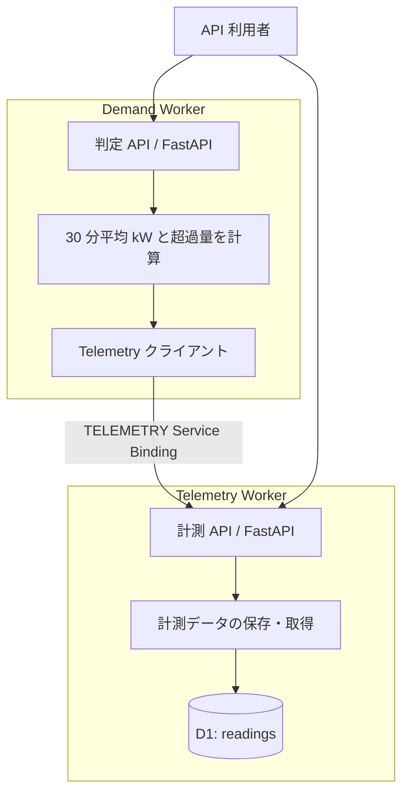
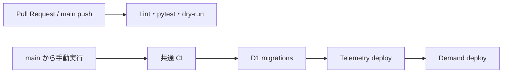

# 設計メモ

## 目的と構成の評価

FastAPI + uv + GitHub + GitHub Actions + Cloudflare Workers は、HTTP API を中心とする小規模な EMS の学習・技術検証に適した組み合わせです。型付きの API、依存関係の固定、サービスごとのデプロイ、CI による検証を、小さな構成で体験できます。

Cloudflare は [FastAPI を Python Workers 上でサポート](https://developers.cloudflare.com/workers/languages/python/packages/fastapi/)しています。Workers では Cloudflare の ASGI アダプターを使い、ローカルの CPython 開発では Uvicorn を使います。業務ルールは両方で共有します。

Workers の Python は [Pyodide を使う実行環境](https://developers.cloudflare.com/workers/languages/python/how-python-workers-work/)です。CPython 向けのネイティブ拡張を無条件には持ち込めないため、追加ライブラリは [対応状況](https://developers.cloudflare.com/workers/languages/python/packages/)を確認します。大規模な予測・最適化処理には、コンテナなど別の実行基盤を組み合わせる余地を残します。

## サービス境界



Telemetry が計測値のスキーマ・保存先を所有し、Demand はその公開 API から最新値を取得します。Demand が Telemetry の DB を直接読む構成にはしません。Cloudflare では [Service Binding](https://developers.cloudflare.com/workers/runtime-apis/bindings/service-bindings/http/)を使います。ローカルの Uvicorn 開発では HTTP クライアントに置き換えます。

モノレポに 2 サービスを置き、共通の API モデル・認証・計算ルールを整理します。学習時の見通しと変更の容易さを優先しています。独立したチーム・リリース周期が必要になった段階で、共通モジュールの版管理やリポジトリ分割を検討します。

## データと電力計算

1 つのレコードは、サイト `site_id` と UTC の区間開始 `interval_start` に対する、固定 30 分間の消費電力量 `energy_kwh` です。日時はタイムゾーンを必須にし、UTC の `00` / `30` 分境界へ揃えます。

```text
average_demand_kw = energy_kwh / 0.5
excess_kw = max(average_demand_kw - contract_kw, 0)
exceeded = average_demand_kw > contract_kw

例: 55 kWh → 110 kW、契約 100 kW → 超過 10 kW
```

契約値と同値以下なら `within_limit`、上回ると `exceeded` です。同じサイト・区間・電力量の再送は受け入れ、既存の区間へ異なる電力量を登録すると `409` を返します。

契約電力はサンプルではクエリで受け取ります。実システムでは、サイトごとの契約、適用期間、権限を管理する責務を追加します。古い計測値を現在の状態として扱わないため、Demand は区間終了からの鮮度を検査します。90 分を超えた場合は `409` を返します。

この判定は、受け取った 30 分電力量の平均電力と契約値の比較です。計測中のデマンド予測、月次の最大需要電力管理、請求上の契約判定とは別に設計する必要があります。

## 保存先

CPython 開発では SQLite、Workers では D1 を利用します。同じ計測テーブルのスキーマを持ちますが、ファイルやデータの実体は共有しません。D1 はマイグレーション、ローカル SQLite はアダプターによる初期化でテーブルを作ります。Workers のローカル D1 もリモート D1 とは別です。

D1 は、学習用の小さな計測データ・サイト情報を少ない構成で永続化するための選択です。実運用で高頻度・多数拠点の時系列データを蓄積する場合は、取込量、保持期間、集約・検索パターンを測り、PostgreSQL / TimescaleDB などを比較します。大量データ向け DB をサービスごとに先に増やすことは、この段階では避けています。

## 認証・障害時の動作

- 業務 API は Bearer トークンを検証します。両サービス共通の `API_TOKEN` は学習用の簡略化です。
- Worker secrets が未設定なら `503` とし、認証のない状態で業務 API を公開しません。
- `/healthz` は認証不要の疎通確認です。依存サービス・DB を含む業務処理全体の正常性はスモークテストで確認します。
- Service Binding はサービス間の接続を提供します。アプリ側の認証も共通ルールで適用します。
- 計測値がない、古い、上流 API が失敗した、といった状態は成功した判定結果として扱いません。
- `x-request-id` をサービス間で引き継ぎ、サービス名・HTTP メソッド・ステータス・処理時間の JSON ログを出力します。トークンや計測データはこのログへ含めません。

実運用では、利用者・機器・サービスごとの認証、サイト単位の認可、トークン更新、レート制限、監査ログを追加します。実機の制御はこの雛形に含めていません。

## CI/CD と検証の範囲

CI は lockfile から環境を作り、Ruff・pytest・両 Worker のバンドルを確認します。デプロイ Workflow も同じ CI を呼び出し、`main` の検証済みコードから staging の D1 と両 Worker を順に更新します。



pytest は CPython 上の業務ルールと API の振る舞いを検証します。dry-run は設定・依存関係のバンドルを検証します。Workers の実行時互換性、D1、Service Binding を通る結合確認には、`pywrangler dev` または staging に対するスモークテストを使います。

2 サービスのデプロイは一括トランザクションではありません。Telemetry 更新後に Demand が失敗する場合もあるため、API 変更は既存クライアントとの互換性を保ちます。DB マイグレーションも追加変更を先に行い、利用コードの切り替え後に不要な構造を削除する段階的な変更を基本にします。

## 拡張の順序

1. サイト・契約情報の永続化と、サイトごとの認可。
2. 現在の JSON ログを利用した監視、依存先を含むトレース、staging の API スモークテストの自動化。
3. 計測データの再送・重複・順序逆転を考慮した取込と、Queues による非同期処理。
4. 保持・集約ポリシーと、負荷測定に基づく時系列 DB の選定。
5. コンテナ等での予測・最適化処理と、設備側の制約を含む制御設計。

まずは 2 サービス間の同期 API を理解し、処理の遅延・量・独立性の要求が出た箇所から非同期化します。
